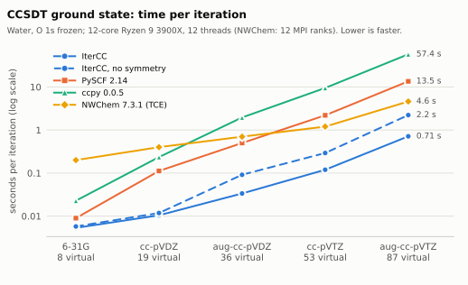

# IterCC

**Exact high-order coupled cluster, fast: CCSDT and CCSDTQ energies, EOM-CCSDT
excited states and CCSDT polarizabilities, on multi-core CPUs and GPUs.**

IterCC solves the full (not perturbative) coupled-cluster equations for
closed-shell molecules through quadruple excitations. Give it a PySCF RHF
calculation; get energies, excitation energies and frequency-dependent
polarizabilities converged to tight thresholds.

<picture>
  <source media="(prefers-color-scheme: dark)" srcset="docs/images/ccsdt-scaling-dark.svg">
  
</picture>

## Highlights

- **Fast where it counts.** On one 56-core cluster CPU socket, water CCSDT in
  aug-cc-pVTZ converges in 2.4 s with IterCC, against 30 s for NWChem, 136 s
  for PySCF and 383 s for ccpy. An aug-cc-pVDZ CCSDTQ iteration is 33 times
  faster than NWChem's and 350 times faster than PySCF's, and an aug-cc-pVQZ
  CCSD iteration 11 to 99 times faster than those of NWChem, PySCF, Psi4 and
  ccpy. On one core, a cc-pVTZ CCSDT iteration takes 0.43 s in IterCC and
  162 s in ORCA 6.1.1. [Benchmarks](docs/benchmarks.md)
- **Big calculations.** One 56-core CPU socket runs a CCSDT iteration with 13
  occupied and 131 virtual orbitals in 9.2 s (an A100 GPU: 26.6 s), and a
  CCSDTQ iteration with 13 occupied and 47 virtual orbitals in 85 s.
- **Beyond energies.** Singlet EOM-CCSDT excitation energies and full CCSDT
  linear-response polarizabilities (static, dynamic, damped) with exact
  analytic Jacobians.
- **Exact and reproducible.** Every rank's raw residual is converged, results
  are bitwise identical for any thread count and instruction set, and CCSDTQ runs resume from
  checkpoints bit for bit. Validated against PySCF, NWChem, exact
  diagonalization and an independent implementation (about 940 tests).
- **Easy to drive.** PySCF in, numbers out; no input files. Point an AI
  assistant at [`llms.txt`](llms.txt) and it can run IterCC for you.

## Install

```sh
pip install "itercc[pyscf] @ git+https://github.com/hallaschristian/itercc"
```

Linux or WSL with Python 3.10+ and a C++ compiler with OpenMP (g++ 8 or
newer). The compiled core builds itself on first use (about 10 s). For NVIDIA
GPUs also install CuPy (`pip install cupy-cuda12x`).

## Quick start

```python
from pyscf import gto, scf
from itercc import RestrictedCC, EOMSinglet, DipoleResponse
from itercc.pyscf_interface import from_rhf, dipole_integrals

mol = gto.M(atom="O 0 0 0.117; H 0 0.757 -0.469; H 0 -0.757 -0.469",
            basis="cc-pvdz", symmetry=True)
mf = scf.RHF(mol).run()
model = from_rhf(mf, frozen=1)                      # MO integrals and symmetry labels, O 1s frozen

cc = RestrictedCC(model.h, model.eri, model.nocc, model.constant,
                  orbital_irreps=model.orbital_irreps, symmetry_tolerance=1e-8)
ground = cc.solve(energy_tol=1e-12, residual_tol=1e-10)
print(ground.energy)                                # CCSDT: -76.24118626 Eh

states = EOMSinglet(cc, ground.amplitudes, orbital_irreps=model.orbital_irreps,
                    irrep=2).solve(nroots=3, residual_tol=1e-6)
print(states.excitation_energies)                   # B1 singlets, Eh

dipoles, irreps = dipole_integrals(model, mol)
response = DipoleResponse(cc, ground.amplitudes, dipoles,
                          orbital_irreps=model.orbital_irreps, dipole_irreps=irreps)
print(response.polarizability(532.0).tensor_au.real)  # 3x3 polarizability at 532 nm, au
```

CCSDTQ, GPUs, checkpoints and every option: [user guide](docs/guide.md).
More scripts: [examples](examples/).

## What it computes

| | Ground state | Excited states | Properties |
| --- | --- | --- | --- |
| CCSD | `RestrictedCC(rank=2)` | `EOMSinglet(method="ccsd")` | `DipoleResponse(method="ccsd")` |
| CCSDT | `RestrictedCC` | `EOMSinglet` | `DipoleResponse` |
| CCSDTQ | `RestrictedCCSDTQ` | triplet spin-flip EOM (experimental) | static, by finite fields |

Plus first-order spin-orbit state interaction (`spin_orbit_state_interaction`),
X2C SOC operators from PySCF (one-electron, and two-electron mean-field
contractions) and active-space utilities (`fold_closed_shell`,
`select_active_orbitals`). Closed-shell (RHF) references only; no
perturbative (T)/(Q) corrections, gradients or open shells.

## Documentation

- [User guide](docs/guide.md): inputs, every method and option, GPUs, tuning
- [Benchmarks](docs/benchmarks.md): IterCC against PySCF, ccpy, NWChem and ORCA
- [Design](docs/design.md): how it is fast and how it stays exact
- [`llms.txt`](llms.txt): the complete usage guide for AI assistants

## Tests

```sh
pip install ".[test]" && pytest -q               # add ITERCC_TEST_CUDA=1 for the GPU tests
```

## License

Apache-2.0 ([LICENSE](LICENSE)). Parts of the equations are adapted from
[pdaggerq](https://github.com/edeprince3/pdaggerq) and
[PySCF](https://github.com/pyscf/pyscf), both Apache-2.0; see
[THIRD_PARTY.md](THIRD_PARTY.md).
