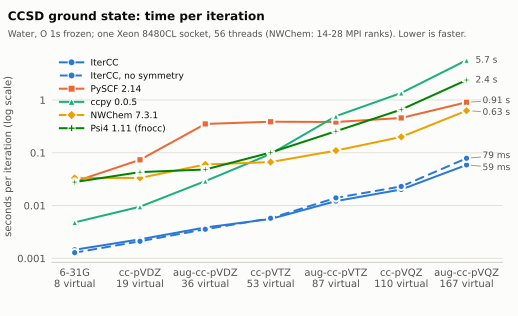
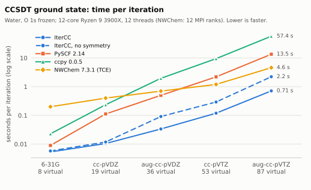
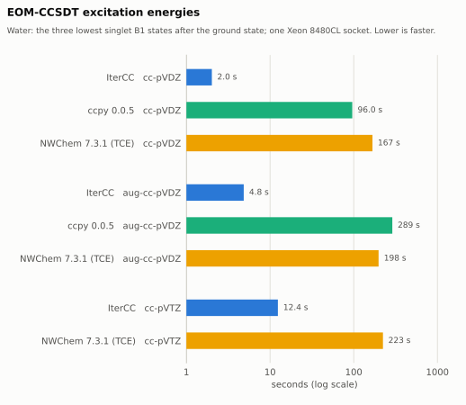
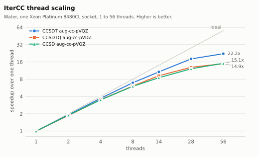

# Benchmarks

IterCC against other coupled-cluster programs on the same molecule, basis
sets, frozen core, thresholds and machine: CCSD, CCSDT and CCSDTQ ground
states, EOM-CCSDT excited states and CCSD and CCSDT polarizabilities.

**In short** (water; one 56-core cluster CPU socket per run):

- **CCSD**: IterCC has the fastest iteration of five programs at every basis
  set. In aug-cc-pVQZ (167 virtual orbitals) an iteration takes 0.15 s: 4x
  faster than NWChem, 6x faster than PySCF, 16x faster than Psi4 and 39x
  faster than ccpy. The whole calculation takes 5.0 s, against 6.9 s for
  NWChem, 12.6 s for PySCF, 29 s for Psi4 and 101 s for ccpy.
- **CCSDT**: in aug-cc-pVTZ an iteration takes 0.17 s: 9x faster than NWChem,
  52x faster than PySCF and 170x faster than ccpy. The whole calculation takes
  3.3 s, against 30 s for NWChem, 136 s for PySCF and 383 s for ccpy. IterCC
  converges aug-cc-pVQZ CCSDT in 25 s; there NWChem's iteration takes 8.6 s.
- **CCSDTQ**: in aug-cc-pVDZ an IterCC iteration takes 0.49 s: 33x faster than
  NWChem, 350x faster than PySCF's fastest variant and 1800x faster than ccpy.
  IterCC converges it in 12.5 s and 4 GiB, NWChem in 335 s and 66 GiB.
- **EOM-CCSDT**: three excited states take 11x to 39x less time than in
  NWChem and 22x to 30x less than in ccpy.
- **Polarizabilities**: CCSDT linear response takes 7x to 18x less time than
  in NWChem, the one other program here that has it. For CCSD, IterCC and Psi4
  give the same values to every digit shown; Psi4 is faster from aug-cc-pVDZ
  on.
- **ORCA** (one core of a desktop, as its Windows build runs coupled cluster
  serially): a cc-pVTZ CCSDT iteration takes 162 s in ORCA 6.1.1 and 0.43 s in
  IterCC on the same core (370x).
- All converged CCSD, CCSDT and CCSDTQ energies agree with IterCC's to within
  6e-8 Eh (ORCA, which tests only its residual: 2e-7 Eh).

## Setup

- **Programs**: IterCC (main branch, after 0.8.0);
  [PySCF](https://github.com/pyscf/pyscf) 2.14.0 (`pyscf.cc.ccsd`, `rccsdt`
  and `rccsdtq`, plus the high-memory `_highm` variants of the last two, which
  the figures show because they are faster);
  [Psi4](https://psicode.org) 1.11 (`fnocc` CCSD and its CCSD polarizability);
  [ccpy](https://github.com/piecuch-group/ccpy) 0.0.5 (`coupled-cluster-py`,
  Piecuch group); [NWChem](https://nwchemgit.github.io) 7.3.1 (its CCSD module
  for CCSD and TCE for the rest), built from the release source with
  `CCSDTQ=y` and `CCSDTLR=y` (`benchmarks/build_nwchem.sh`; the conda-forge
  package has neither CCSDTQ nor CCSDT response);
  [ORCA](https://www.faccts.de/orca/) 6.1.1 (AUTOCI CCSDT and CCSDTQ, on one
  core, in [its own section](#one-core-with-orca); F. Neese, WIREs Comput.
  Mol. Sci. 2025, 15, e70019). Every program runs with its own default
  algorithms. PySCF, ccpy and IterCC start from the same PySCF RHF orbitals.
- **System**: water with the O 1s orbital frozen (4 correlated occupied
  orbitals), basis sets from 6-31G (8 virtual orbitals) to aug-cc-pVQZ (167).
  IterCC uses the molecule's C2v symmetry; "IterCC, no symmetry" shows the same
  code without it (PySCF and ccpy do not use point-group symmetry; NWChem and
  Psi4 do).
- **Machine**: one cluster node with two Intel Xeon Platinum 8480CL
  processors (Sapphire Rapids, 56 cores each) and 1 TB of memory. Every run
  gets one socket, its 56 cores and its own memory (`numactl --cpunodebind
  --membind`), and runs alone on the node. IterCC, PySCF, Psi4 and ccpy use 56
  threads. NWChem runs MPI ranks pinned to cores, 14 for the basis sets up to
  cc-pVDZ and 28 above, because more ranks were slower (a cc-pVDZ CCSDT
  iteration: 0.5 s on 14 ranks, 1.2 s on 56, 2.5 s on 56 unpinned).
- **Thresholds**: energy change 1e-8 Eh and residual 1e-6 (each program's
  own residual measure); polarizabilities to 1e-6.
- **Measured**: the median wall time of one iteration, and the time from the
  converged RHF to the converged energy (integral transformation included).
  Times marked * come from runs stopped after one to three iterations because
  converging them would have taken hours.

## CCSD

<picture>
  <source media="(prefers-color-scheme: dark)" srcset="images/ccsd-scaling-dark.svg">
  
</picture>

Seconds per iteration (virtual orbitals in parentheses):

| | 6-31G (8) | cc-pVDZ (19) | aug-cc-pVDZ (36) | cc-pVTZ (53) | aug-cc-pVTZ (87) | cc-pVQZ (110) | aug-cc-pVQZ (167) |
| --- | --- | --- | --- | --- | --- | --- | --- |
| IterCC | 2 ms | 2 ms | 4 ms | 6 ms | 21 ms | 51 ms | 0.15 s |
| IterCC, no symmetry | 1 ms | 2 ms | 4 ms | 12 ms | 32 ms | 53 ms | 0.14 s |
| PySCF 2.14 | 28 ms | 74 ms | 0.35 s | 0.39 s | 0.38 s | 0.46 s | 0.91 s |
| Psi4 1.11 (fnocc) | 28 ms | 43 ms | 48 ms | 0.10 s | 0.26 s | 0.66 s | 2.4 s |
| NWChem 7.3.1 (CCSD) | 33 ms | 33 ms | 60 ms | 67 ms | 0.11 s | 0.20 s | 0.63 s |
| ccpy 0.0.5 | 5 ms | 10 ms | 29 ms | 95 ms | 0.49 s | 1.4 s | 5.7 s |

Time from RHF to the converged CCSD energy (iterations, peak memory):

| | 6-31G (8) | cc-pVDZ (19) | aug-cc-pVDZ (36) | cc-pVTZ (53) | aug-cc-pVTZ (87) | cc-pVQZ (110) | aug-cc-pVQZ (167) |
| --- | --- | --- | --- | --- | --- | --- | --- |
| IterCC | 88 ms (12 it., 0.1 GiB) | 0.14 s (12 it., 0.3 GiB) | 0.17 s (12 it., 0.3 GiB) | 0.23 s (12 it., 0.5 GiB) | 0.75 s (13 it., 2.1 GiB) | 1.5 s (13 it., 4.5 GiB) | 5.0 s (13 it., 21.5 GiB) |
| IterCC, no symmetry | 80 ms (12 it., 0.1 GiB) | 0.14 s (12 it., 0.3 GiB) | 0.16 s (12 it., 0.3 GiB) | 0.27 s (12 it., 0.4 GiB) | 0.90 s (13 it., 1.7 GiB) | 1.7 s (13 it., 3.8 GiB) | 4.9 s (13 it., 17.2 GiB) |
| PySCF 2.14 | 0.34 s (9 it., 0.2 GiB) | 0.77 s (9 it., 0.3 GiB) | 4.2 s (12 it., 0.4 GiB) | 4.0 s (11 it., 0.5 GiB) | 4.0 s (10 it., 0.6 GiB) | 5.0 s (10 it., 1.1 GiB) | 12.6 s (11 it., 4.1 GiB) |
| Psi4 1.11 (fnocc) | 0.25 s (9 it., 1.0 GiB) | 0.39 s (9 it., 1.9 GiB) | 0.48 s (10 it., 1.9 GiB) | 0.91 s (9 it., 2.0 GiB) | 3.1 s (12 it., 2.2 GiB) | 5.9 s (9 it., 3.5 GiB) | 28.7 s (12 it., 7.2 GiB) |
| NWChem 7.3.1 (CCSD) | 0.30 s (9 it., 3.9 GiB) | 0.30 s (9 it., 3.9 GiB) | 0.60 s (10 it., 6.1 GiB) | 0.60 s (9 it., 6.2 GiB) | 1.1 s (10 it., 6.5 GiB) | 2.0 s (10 it., 7.2 GiB) | 6.9 s (11 it., 8.8 GiB) |
| ccpy 0.0.5 | 70 ms (11 it., 0.2 GiB) | 0.14 s (10 it., 0.2 GiB) | 0.52 s (12 it., 0.5 GiB) | 1.6 s (11 it., 1.0 GiB) | 8.6 s (12 it., 3.1 GiB) | 20.5 s (11 it., 8.2 GiB) | 101 s (12 it., 39.9 GiB) |

For the smallest basis sets every program finishes in well under a second
of coupled-cluster work, and fixed costs decide the order. In aug-cc-pVQZ
IterCC's 13 iterations take 1.9 s of its 5.0 s.

## CCSDT

<picture>
  <source media="(prefers-color-scheme: dark)" srcset="images/ccsdt-scaling-dark.svg">
  
</picture>

Seconds per iteration:

| | 6-31G (8) | cc-pVDZ (19) | aug-cc-pVDZ (36) | cc-pVTZ (53) | aug-cc-pVTZ (87) | cc-pVQZ (110) | aug-cc-pVQZ (167) |
| --- | --- | --- | --- | --- | --- | --- | --- |
| IterCC | 5 ms | 7 ms | 16 ms | 34 ms | 0.17 s | 0.38 s | 1.4 s |
| IterCC, no symmetry | 4 ms | 9 ms | 23 ms | 92 ms | 0.51 s | 1.1 s | 6.1 s* |
| PySCF 2.14, `_highm` | 0.21 s | 0.40 s | 0.77 s | 1.8 s | 9.1 s | 19.5 s | 75.4 s* |
| PySCF 2.14, default | 0.42 s | 1.2 s | 2.6 s | 5.2 s | 24.9 s | 56.1 s* | 217 s* |
| ccpy 0.0.5 | 22 ms | 0.18 s | 1.6 s | 5.7 s | 29.3 s | 59.7 s* |  |
| NWChem 7.3.1 (TCE) | 0.30 s | 0.50 s | 0.70 s | 0.70 s | 1.5 s | 2.5 s | 8.6 s* |

Time from RHF to the converged CCSDT energy (iterations, peak memory):

| | 6-31G (8) | cc-pVDZ (19) | aug-cc-pVDZ (36) | cc-pVTZ (53) | aug-cc-pVTZ (87) | cc-pVQZ (110) | aug-cc-pVQZ (167) |
| --- | --- | --- | --- | --- | --- | --- | --- |
| IterCC | 0.15 s (13 it., 0.1 GiB) | 0.17 s (13 it., 0.2 GiB) | 0.39 s (15 it., 0.4 GiB) | 0.78 s (16 it., 0.7 GiB) | 3.3 s (16 it., 2.8 GiB) | 6.9 s (16 it., 5.8 GiB) | 24.7 s (16 it., 25.8 GiB) |
| IterCC, no symmetry | 0.15 s (13 it., 0.1 GiB) | 0.22 s (13 it., 0.2 GiB) | 0.51 s (15 it., 0.5 GiB) | 1.8 s (16 it., 0.8 GiB) | 8.2 s (16 it., 3.2 GiB) | 18.4 s (16 it., 6.8 GiB) | - |
| PySCF 2.14, `_highm` | 2.6 s (12 it., 0.2 GiB) | 4.9 s (12 it., 0.5 GiB) | 10.7 s (14 it., 1.3 GiB) | 21.4 s (12 it., 2.0 GiB) | 136 s (15 it., 4.8 GiB) | 272 s (14 it., 9.6 GiB) | - |
| PySCF 2.14, default | 4.9 s (12 it., 0.2 GiB) | 13.7 s (12 it., 0.6 GiB) | 37.2 s (14 it., 1.1 GiB) | 62.8 s (12 it., 1.7 GiB) | 374 s (15 it., 4.3 GiB) | - | - |
| ccpy 0.0.5 | 0.26 s (11 it., 0.2 GiB) | 1.8 s (10 it., 0.7 GiB) | 18.3 s (11 it., 2.7 GiB) | 63.6 s (11 it., 5.6 GiB) | 383 s (13 it., 23.3 GiB) | - |  |
| NWChem 7.3.1 (TCE) | 4.8 s (14 it., 3.9 GiB) | 7.7 s (16 it., 4.0 GiB) | 12.0 s (17 it., 6.9 GiB) | 12.4 s (16 it., 8.9 GiB) | 29.8 s (18 it., 34.1 GiB) | 48.4 s (17 it., 73.2 GiB) | - |

IterCC's lead over PySCF's faster variant is about 50x at every size.
NWChem's iteration has a fixed cost of a few tenths of a second, so its gap
to IterCC narrows from 60x in the small basis sets to 6x in aug-cc-pVQZ,
where NWChem's 28 ranks held 300 GiB of memory.

## CCSDTQ

<picture>
  <source media="(prefers-color-scheme: dark)" srcset="images/ccsdtq-scaling-dark.svg">
  
</picture>

Seconds per iteration:

| | 6-31G (8) | 6-31G* (13) | cc-pVDZ (19) | aug-cc-pVDZ (36) | cc-pVTZ (53) |
| --- | --- | --- | --- | --- | --- |
| IterCC | 37 ms | 47 ms | 75 ms | 0.49 s | 2.5 s |
| IterCC, no symmetry | 28 ms | 60 ms | 0.21 s | 3.0 s* |  |
| PySCF 2.14, `_highm` | 0.93 s | 2.2 s | 9.6 s | 170 s* |  |
| PySCF 2.14, default | 3.3 s | 12.0 s | 57.2 s* | 1078 s* |  |
| ccpy 0.0.5 | 2.3 s | 10.8 s | 54.1 s* | 886 s* |  |
| NWChem 7.3.1 (TCE) | 2.6 s | 6.2 s | 6.5 s | 16.2 s |  |

Time from RHF to the converged CCSDTQ energy (iterations, peak memory):

| | 6-31G (8) | 6-31G* (13) | cc-pVDZ (19) | aug-cc-pVDZ (36) | cc-pVTZ (53) |
| --- | --- | --- | --- | --- | --- |
| IterCC | 1.6 s (12 it., 0.2 GiB) | 3.5 s (13 it., 0.3 GiB) | 4.3 s (13 it., 0.7 GiB) | 12.5 s (15 it., 4.0 GiB) | 47.6 s (15 it., 16.2 GiB) |
| IterCC, no symmetry | 0.56 s (12 it., 0.2 GiB) | 1.1 s (13 it., 0.3 GiB) | 3.0 s (13 it., 0.9 GiB) | - |  |
| PySCF 2.14, `_highm` | 10.0 s (11 it., 0.6 GiB) | 23.7 s (11 it., 1.2 GiB) | 125 s (13 it., 3.4 GiB) | - |  |
| PySCF 2.14, default | 36.7 s (11 it., 0.5 GiB) | 134 s (11 it., 1.2 GiB) | - | - |  |
| ccpy 0.0.5 | 28.0 s (12 it., 1.3 GiB) | 130 s (12 it., 5.2 GiB) | - | - |  |
| NWChem 7.3.1 (TCE) | 39.3 s (16 it., 4.0 GiB) | 90.8 s (16 it., 4.6 GiB) | 103 s (17 it., 6.6 GiB) | 335 s (21 it., 66.1 GiB) |  |

IterCC converges cc-pVTZ CCSDTQ (53 virtual orbitals) in 48 s and 16 GiB;
the other programs were not run there. With symmetry, IterCC spends 1 to 3 s
planning its symmetry-blocked T4 products before the first iteration, so for
the smallest basis sets the code without symmetry finishes first. All IterCC
runs use the default settings. On the CPU these put T4 into DIIS
(`diis_quadruples="auto"`); the aug-cc-pVDZ case needs it, as damped Jacobi
steps on T4 alone had not converged after 200 iterations.

## EOM-CCSDT

The three lowest singlet B1 states, starting from the converged ground state,
each root converged to a residual norm of 1e-5.

<picture>
  <source media="(prefers-color-scheme: dark)" srcset="images/eom-ccsdt-dark.svg">
  
</picture>

| | Basis | Seconds | Roots (eV) |
| --- | --- | --- | --- |
| IterCC | cc-pVDZ | 4.3 s | 8.232, 23.042, 23.427 |
| ccpy 0.0.5 | cc-pVDZ | 96.0 s | 8.232, 23.427, 31.035 |
| NWChem 7.3.1 (TCE) | cc-pVDZ | 167 s | 8.232, 23.041, 23.427 |
| IterCC | aug-cc-pVDZ | 9.6 s | 7.510, 11.162, 11.973 |
| ccpy 0.0.5 | aug-cc-pVDZ | 289 s | 7.510, 11.162, 11.973 |
| NWChem 7.3.1 (TCE) | aug-cc-pVDZ | 198 s | 7.510, 11.163, 11.973 |
| IterCC | cc-pVTZ | 19.7 s | 8.121, 18.477, 20.448 |
| NWChem 7.3.1 (TCE) | cc-pVTZ | 223 s | 8.121, 18.477, 20.448 |

ccpy follows its CIS guesses root by root; in cc-pVDZ it converged to a
higher state (31.0 eV) in place of the 23.04 eV state that IterCC and NWChem
find. IterCC returns the lowest roots of the symmetry sector.

## Polarizabilities

Static and 532 nm isotropic polarizabilities from coupled-cluster linear
response (IterCC: `DipoleResponse`; Psi4: `properties("ccsd",
properties=["polarizability"])`; NWChem: TCE `lineresp`). The time is all
coupled-cluster work after SCF: the ground state and both frequencies.

| Method | Program | Basis | static | 532 nm | CC time |
| --- | --- | --- | --- | --- | --- |
| CCSD | IterCC | cc-pVDZ | 5.1630 | 5.2693 | 0.99 s |
| CCSD | Psi4 1.11 | cc-pVDZ | 5.1630 | 5.2693 | 1.7 s |
| CCSD | NWChem 7.3.1 | cc-pVDZ | 5.1623 | 5.2685 | 40.6 s |
| CCSD | IterCC | aug-cc-pVDZ | 9.2223 | 9.4691 | 4.6 s |
| CCSD | Psi4 1.11 | aug-cc-pVDZ | 9.2223 | 9.4691 | 3.6 s |
| CCSD | NWChem 7.3.1 | aug-cc-pVDZ | 9.2195 | 9.4661 | 78.4 s |
| CCSD | IterCC | cc-pVTZ | 6.9829 | 7.1219 | 14.5 s |
| CCSD | Psi4 1.11 | cc-pVTZ | 6.9829 | 7.1219 | 5.4 s |
| CCSD | NWChem 7.3.1 | cc-pVTZ | 6.9823 | 7.1212 | 76.0 s |
| CCSD | IterCC | aug-cc-pVTZ | 9.4814 | 9.7285 | 32.6 s |
| CCSD | Psi4 1.11 | aug-cc-pVTZ | 9.4814 | 9.7285 | 17.0 s |
| CCSD | NWChem 7.3.1 | aug-cc-pVTZ | 9.4775 | 9.7243 | 85.9 s |
| CCSDT | IterCC | cc-pVDZ | 5.1482 | 5.2534 | 15.2 s |
| CCSDT | NWChem 7.3.1 | cc-pVDZ | 5.1472 | 5.2523 | 273 s |
| CCSDT | IterCC | aug-cc-pVDZ | 9.1576 | 9.4013 | 34.7 s |
| CCSDT | NWChem 7.3.1 | aug-cc-pVDZ | 9.1549 | 9.3984 | 414 s |
| CCSDT | IterCC | cc-pVTZ | 6.9522 | 7.0909 | 59.7 s |
| CCSDT | NWChem 7.3.1 | cc-pVTZ | 6.9514 | 7.0900 | 402 s |

IterCC and Psi4 agree to every digit shown. NWChem's values are lower in the
fourth digit because its response equations treat the frozen core
differently: with all electrons correlated its CCSD polarizabilities are
within 7e-5 (relative) of IterCC's. Psi4 has a dedicated CCSD response code
and is up to 2.7x faster from aug-cc-pVDZ on; IterCC differentiates its
general residual, which is what gives it CCSDT response.

## Thread scaling

IterCC's speedup over one thread, from the time per iteration: 1 to 56
threads on one socket, and 112 threads on the whole node (memory interleaved
over both sockets).

<picture>
  <source media="(prefers-color-scheme: dark)" srcset="images/thread-scaling-dark.svg">
  
</picture>

On one socket CCSDT gains 19x from 56 threads and CCSDTQ 15x. CCSD, whose
aug-cc-pVQZ iteration takes 0.13 s on 28 threads, gains nothing beyond 28.
The second socket adds nothing, so one socket per calculation is the best use
of a node. EOM and response solves do not gain from more than 12 cores:
their times here are about those of the 12-core desktop below.

## One core, with ORCA

ORCA's AUTOCI module solves full CCSDT (closed-shell code) and CCSDTQ (only
in its spin-unrestricted code); it has no EOM-CCSDT. The Windows build of
ORCA 6.1.1 used here ships no parallel AUTOCI, so this comparison gives every
program one core of a desktop (AMD Ryzen 9 3900X; NWChem one MPI rank). ORCA
ran natively under Windows on the same machine, the others under WSL2. ORCA's
convergence test is the largest residual element (1e-6, as for IterCC); it
has no energy threshold.

<picture>
  <source media="(prefers-color-scheme: dark)" srcset="images/single-core-dark.svg">
  
</picture>

Seconds per iteration on one core (time to the converged energy, iterations):

| | CCSDT 6-31G | CCSDT cc-pVDZ | CCSDT aug-cc-pVDZ | CCSDT cc-pVTZ | CCSDTQ 6-31G |
| --- | --- | --- | --- | --- | --- |
| IterCC | 4 ms (0.25 s, 13) | 18 ms (0.42 s, 13) | 0.11 s (1.9 s, 15) | 0.43 s (7.1 s, 16) | 37 ms (1.5 s, 12) |
| PySCF 2.14, `_highm` | 5 ms (66 ms, 12) | 0.12 s (1.4 s, 12) | 0.72 s (10.2 s, 14) | 3.2 s (39.0 s, 12) | 0.54 s (6.0 s, 11) |
| PySCF 2.14, default | 12 ms (0.15 s, 12) | 0.36 s (4.4 s, 12) | 1.9 s (26.1 s, 14) | 7.4 s (90.1 s, 12) | 2.9 s* |
| ccpy 0.0.5 | 20 ms (0.23 s, 11) | 0.23 s (2.4 s, 10) | 2.7 s (29.8 s, 11) | 11.9 s (131 s, 11) | 7.6 s* |
| NWChem 7.3.1 (TCE) | 0.40 s (6.4 s, 14) | 1.0 s (15.8 s, 16) | 1.4 s (25.7 s, 17) | 2.6 s (45.2 s, 16) |  |
| ORCA 6.1.1 (AUTOCI) | 5.8 s (75.2 s, 11) | 9.2 s (116 s, 11) | 21.4 s (280 s, 12) | 162 s (1985 s, 12) | 160 s* |

ORCA spends about 5.7 s on every iteration even for the smallest basis, so
fixed costs dominate its small cases; in cc-pVTZ its iteration is 370 times
IterCC's. Against the other programs IterCC's lead is smaller on one core
than on a 56-core socket (in cc-pVTZ, 7x over PySCF and 6x over NWChem,
against 53x and 21x), because IterCC also gains more from extra cores; on the
smallest basis PySCF's `_highm` and IterCC tie.

## On a 12-core desktop

The same comparison on an AMD Ryzen 9 3900X (12 cores, two memory channels,
15 GiB under WSL2; every program 12 threads or 12 MPI ranks), seconds per
iteration (PySCF: `_highm` for CCSDT and CCSDTQ):

| | IterCC | NWChem | PySCF | Psi4 | ccpy | ORCA |
| --- | --- | --- | --- | --- | --- | --- |
| CCSD aug-cc-pVTZ | 33 ms | 1.8 s | 0.16 s | 0.40 s | | 0.44 s |
| CCSDT aug-cc-pVTZ | 0.77 s | 4.6 s | 13.5 s | | 57.4 s* | |
| CCSDTQ cc-pVDZ | 0.14 s | 8.9 s | 8.4 s | | 73.5 s* | |
| CCSDTQ aug-cc-pVDZ | 2.3 s | | out of memory | | | |

ORCA ran CCSD (MDCI) with up to 12 processes. A 12-core desktop feeds its
cores from two memory channels, and IterCC gains about 4x from 12 threads
there (CCSD 2.6x). The records are in
`benchmarks/results/water-ryzen9-3900x*.jsonl`.

## Larger systems

On a 56-core Sapphire Rapids socket (Intel Xeon 8480CL, memory bound to the
socket), and on one NVIDIA A100 running IterCC's CUDA path, seconds per
iteration with 13 correlated occupied orbitals in C2v symmetry:

| Method | Virtual orbitals | CPU socket | A100 |
| --- | --- | --- | --- |
| CCSDT | 88 | 2.5 | 7.9 |
| CCSDT | 131 | 9.2 | 26.6 |
| CCSDTQ | 47 | 85 | |

## Reproduce

On a Slurm cluster with two-socket nodes:

```sh
pip install "itercc[benchmarks]" coupled-cluster-py==0.0.5   # Psi4 1.11 in its own environment
bash benchmarks/build_nwchem.sh "$PWD/nwchem-env" "$PWD/nwchem-src"
export PYTHON=$(command -v python) COMPARE=$PWD/benchmarks/compare.py PSI4_PYTHON=... \
    NWCHEM_EXE=$PWD/nwchem-src/bin/LINUX64/nwchem \
    NWCHEM_BASIS_LIBRARY=$PWD/nwchem-src/src/basis/libraries/ \
    NWCHEM_MPIRUN="$PWD/nwchem-env/bin/mpirun --bind-to core --map-by core"
sbatch -p PARTITION benchmarks/cluster_campaign.sh benchmarks/cluster_runs.txt results 56
cat results/scaling0.jsonl results/node.jsonl > threads.jsonl
python benchmarks/plot_compare.py results/socket0.jsonl docs/images --threads threads.jsonl \
    --single one-core.jsonl --machine "one Xeon 8480CL socket" --cores 56 --nwchem-ranks 14-28
```

`cluster_runs.txt` lists every run (resubmitting the job continues where the
last one stopped). On one workstation, `benchmarks/compare_campaign.sh`,
`compare_more.sh`, `thread_scaling.sh` and `compare_single_core.sh` (ORCA)
run the desktop set. `python benchmarks/compare.py run --code itercc --method
ccsdt --basis cc-pvtz` runs one point. The records behind this page are in
`benchmarks/results/`. Not compared: MRCC and CFOUR, the reference
implementations of high-order coupled cluster, which need licenses.
