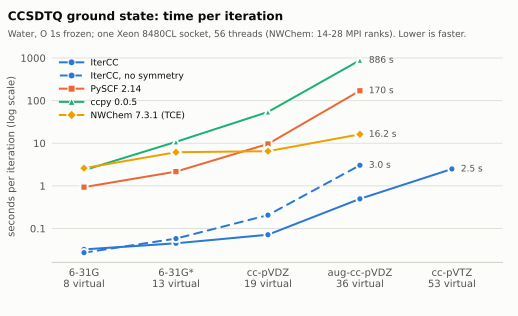
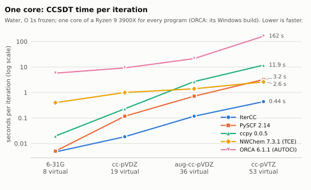

# Benchmarks

IterCC against other programs that solve the full CCSDT, CCSDTQ and
EOM-CCSDT equations, run on the same molecule, basis sets, frozen core,
thresholds and machine.

**In short** (water; 12 cores unless noted):

- **CCSDT**: IterCC is the fastest from cc-pVDZ up. In aug-cc-pVTZ an
  iteration takes 1.2 s: 4x faster than NWChem, 11x faster than PySCF and 49x
  faster than ccpy. The whole calculation takes 19 s, against 94 s for NWChem
  and 201 s for PySCF; ccpy runs out of memory before converging.
- **CCSDTQ**: in cc-pVDZ an IterCC iteration is 61x faster than PySCF's
  fastest variant, 370x faster than its default and 530x faster than ccpy.
  IterCC converges aug-cc-pVDZ CCSDTQ in 41 s with 2.6 GiB of memory; PySCF
  needs more than 13 GiB and the others would need days.
- **EOM-CCSDT**: three excited states take 8x to 30x less time than in NWChem
  and ccpy.
- **ORCA** (one core, as its Windows build runs coupled cluster serially):
  a cc-pVTZ CCSDT iteration takes 162 s in ORCA 6.1.1 and 0.46 s in IterCC on
  the same core (350x), and the whole calculation 33 minutes against 7.8 s. A
  6-31G CCSDTQ iteration takes 160 s in ORCA and 0.034 s in IterCC.
- All converged energies agree with IterCC's to within 5e-8 Eh (ORCA, which
  tests only its residual: 2e-7 Eh).

## Setup

- **Programs**: IterCC 0.8.0; [PySCF](https://github.com/pyscf/pyscf) 2.14.0
  (`pyscf.cc.rccsdt` and `rccsdtq`, plus their high-memory `_highm` variants,
  which the figures show because they are faster);
  [ccpy](https://github.com/piecuch-group/ccpy) 0.0.5 (`coupled-cluster-py`,
  Piecuch group); [NWChem](https://nwchemgit.github.io) 7.3.1 (TCE; the
  conda-forge build has no CCSDTQ); [ORCA](https://www.faccts.de/orca/) 6.1.1
  (AUTOCI; F. Neese, WIREs Comput. Mol. Sci. 2025, 15, e70019), compared on one
  core in [its own section](#one-core-with-orca). Every program runs with its
  own default algorithms. PySCF, ccpy and IterCC start from the same PySCF RHF
  orbitals.
- **System**: water with the O 1s orbital frozen (4 correlated occupied
  orbitals), basis sets from 6-31G (8 virtual orbitals) to aug-cc-pVTZ (87).
  IterCC uses the molecule's C2v symmetry; "IterCC, no symmetry" shows the same
  code without it (PySCF and ccpy do not use point-group symmetry, NWChem does).
- **Machine**: AMD Ryzen 9 3900X (12 cores), 15 GiB of memory under WSL2. Every
  program gets 12 threads (NWChem 12 MPI ranks); one calculation at a time; runs
  over 13 GiB are stopped.
- **Thresholds**: energy change 1e-8 Eh and residual 1e-6 (each program's
  own residual measure).
- **Measured**: the median wall time of one iteration, and the time from the
  converged RHF to the converged energy (integral transformation included).
  Times marked * come from runs stopped after two or three iterations because
  converging them would have taken hours or more memory than the machine has.

## CCSDT

<picture>
  <source media="(prefers-color-scheme: dark)" srcset="images/ccsdt-scaling-dark.svg">
  
</picture>

Seconds per iteration (virtual orbitals in parentheses):

| | 6-31G (8) | cc-pVDZ (19) | aug-cc-pVDZ (36) | cc-pVTZ (53) | aug-cc-pVTZ (87) |
| --- | --- | --- | --- | --- | --- |
| IterCC | 19 ms | 25 ms | 55 ms | 0.18 s | 1.2 s |
| IterCC, no symmetry | 5 ms | 14 ms | 91 ms | 0.32 s | 2.3 s |
| PySCF 2.14, `_highm` | 9 ms | 0.11 s | 0.50 s | 2.2 s | 13.5 s |
| PySCF 2.14, default | 30 ms | 0.36 s | 1.3 s | 5.0 s | 29.7 s |
| ccpy 0.0.5 | 23 ms | 0.24 s | 2.0 s | 9.5 s | 57.4 s* |
| NWChem 7.3.1 (TCE) | 0.20 s | 0.40 s | 0.70 s | 1.2 s | 4.6 s |

Time from RHF to the converged CCSDT energy (iterations, peak memory):

| | 6-31G (8) | cc-pVDZ (19) | aug-cc-pVDZ (36) | cc-pVTZ (53) | aug-cc-pVTZ (87) |
| --- | --- | --- | --- | --- | --- |
| IterCC | 0.48 s (13, 0.1 GiB) | 0.43 s (13, 0.1 GiB) | 0.97 s (15, 0.2 GiB) | 3.1 s (16, 0.6 GiB) | 18.8 s (16, 3.0 GiB) |
| IterCC, no symmetry | 0.18 s (13, 0.1 GiB) | 0.27 s (13, 0.1 GiB) | 1.4 s (15, 0.2 GiB) | 5.3 s (16, 0.6 GiB) | 35.5 s (16, 2.7 GiB) |
| PySCF 2.14, `_highm` | 0.15 s (12, 0.1 GiB) | 1.4 s (12, 0.1 GiB) | 7.2 s (14, 0.5 GiB) | 26.8 s (12, 1.2 GiB) | 201 s (15, 4.0 GiB) |
| PySCF 2.14, default | 0.41 s (12, 0.1 GiB) | 4.4 s (12, 0.1 GiB) | 18.2 s (14, 0.4 GiB) | 62.3 s (12, 1.2 GiB) | 449 s (15, 3.5 GiB) |
| ccpy 0.0.5 | 0.27 s (11, 0.1 GiB) | 2.4 s (10, 0.3 GiB) | 21.7 s (11, 1.7 GiB) | 105 s (11, 5.1 GiB) | out of memory |
| NWChem 7.3.1 (TCE) | 3.7 s (14, 1.6 GiB) | 7.3 s (16, 1.6 GiB) | 14.1 s (17, 1.7 GiB) | 21.6 s (16, 2.1 GiB) | 94.1 s (18, 3.3 GiB) |

For the smallest basis sets, fixed setup costs dominate: there, PySCF's
`_highm` and IterCC without symmetry are quickest, and NWChem's MPI and
file-based setup costs it a few seconds.

## CCSDTQ

<picture>
  <source media="(prefers-color-scheme: dark)" srcset="images/ccsdtq-scaling-dark.svg">
  
</picture>

Seconds per iteration:

| | 6-31G (8) | 6-31G* (13) | cc-pVDZ (19) | aug-cc-pVDZ (36) |
| --- | --- | --- | --- | --- |
| IterCC | 27 ms | 52 ms | 0.14 s | 2.2 s |
| IterCC, no symmetry | 37 ms | 0.12 s | 0.53 s | 9.9 s* |
| PySCF 2.14, `_highm` | 0.40 s | 1.7 s | 8.4 s | out of memory |
| PySCF 2.14, default | 2.6 s | 10.6 s | 51.5 s* | |
| ccpy 0.0.5 | 5.5 s | 16.2 s | 73.5 s* | |

Time from RHF to the converged CCSDTQ energy (iterations, peak memory):

| | 6-31G (8) | 6-31G* (13) | cc-pVDZ (19) | aug-cc-pVDZ (36) |
| --- | --- | --- | --- | --- |
| IterCC | 1.4 s (11, 0.1 GiB) | 3.0 s (13, 0.2 GiB) | 4.4 s (13, 0.3 GiB) | 40.9 s (17, 2.6 GiB) |
| IterCC, no symmetry | 0.56 s (11, 0.1 GiB) | 1.8 s (13, 0.2 GiB) | 7.1 s (13, 0.3 GiB) | |
| PySCF 2.14, `_highm` | 4.5 s (11, 0.2 GiB) | 19.2 s (11, 0.7 GiB) | 108 s (13, 2.7 GiB) | out of memory |
| PySCF 2.14, default | 28.2 s (11, 0.2 GiB) | 118 s (11, 0.7 GiB) | | |
| ccpy 0.0.5 | 65.6 s (12, 0.8 GiB) | 195 s (12, 4.6 GiB) | | |

IterCC's aug-cc-pVDZ run uses the settings the [guide](guide.md#ccsdtq)
gives for diffuse basis sets (`diis_quadruples="host"`, `diis_size=8`,
`damping=0.2`); with the default T4 updates it had not converged after 200
iterations.

## EOM-CCSDT

The three lowest singlet B1 states, starting from the converged ground state,
each root converged to a residual norm of 1e-5.

<picture>
  <source media="(prefers-color-scheme: dark)" srcset="images/eom-ccsdt-dark.svg">
  
</picture>

| | Basis | Time | Excitation energies (eV) |
| --- | --- | --- | --- |
| IterCC | cc-pVDZ | 4.7 s | 8.232, 23.042, 23.427 |
| ccpy 0.0.5 | cc-pVDZ | 113 s | 8.232, 23.427, 31.034 |
| NWChem 7.3.1 (TCE) | cc-pVDZ | 70.6 s | 8.232, 23.041, 23.427 |
| IterCC | aug-cc-pVDZ | 11.7 s | 7.510, 11.162, 11.973 |
| ccpy 0.0.5 | aug-cc-pVDZ | 356 s | 7.510, 11.162, 11.973 |
| NWChem 7.3.1 (TCE) | aug-cc-pVDZ | 99.3 s | 7.510, 11.163, 11.973 |

ccpy follows its CIS guesses root by root; in cc-pVDZ it converged to a
higher state (31.0 eV) in place of the 23.04 eV state that IterCC and NWChem
find. IterCC returns the lowest roots of the symmetry sector.

## One core, with ORCA

ORCA's AUTOCI module solves full CCSDT (closed-shell code) and CCSDTQ (only
in its spin-unrestricted code); it has no EOM-CCSDT. The Windows build of
ORCA 6.1.1 used here ships no parallel AUTOCI, so this comparison gives every
program one core (NWChem one MPI rank). ORCA ran natively under Windows on the
same machine, the others under WSL2. ORCA's convergence test is the largest
residual element (1e-6, as for IterCC); it has no energy threshold.

<picture>
  <source media="(prefers-color-scheme: dark)" srcset="images/single-core-dark.svg">
  
</picture>

Seconds per iteration on one core (time to the converged energy, iterations):

| | CCSDT 6-31G | CCSDT cc-pVDZ | CCSDT aug-cc-pVDZ | CCSDT cc-pVTZ | CCSDTQ 6-31G |
| --- | --- | --- | --- | --- | --- |
| IterCC | 7 ms (0.32 s, 13) | 21 ms (0.51 s, 13) | 0.12 s (2.2 s, 15) | 0.46 s (7.8 s, 16) | 34 ms (1.3 s, 11) |
| PySCF 2.14, `_highm` | 5 ms (66 ms, 12) | 0.12 s (1.4 s, 12) | 0.72 s (10.2 s, 14) | 3.2 s (39.0 s, 12) | 0.54 s (6.0 s, 11) |
| PySCF 2.14, default | 12 ms (0.15 s, 12) | 0.36 s (4.4 s, 12) | 1.9 s (26.1 s, 14) | 7.4 s (90.1 s, 12) | 2.9 s* |
| ccpy 0.0.5 | 20 ms (0.23 s, 11) | 0.23 s (2.4 s, 10) | 2.7 s (29.8 s, 11) | 11.9 s (131 s, 11) | 7.6 s* |
| NWChem 7.3.1 (TCE) | 0.40 s (6.4 s, 14) | 1.0 s (15.8 s, 16) | 1.4 s (25.7 s, 17) | 2.6 s (45.2 s, 16) | |
| ORCA 6.1.1 (AUTOCI) | 5.8 s (75.2 s, 11) | 9.2 s (116 s, 11) | 21.4 s (280 s, 12) | 162 s (1985 s, 12) | 160 s* |

ORCA spends about 5.7 s on every iteration even for the smallest basis, so
fixed costs dominate its small cases; in cc-pVTZ its iteration is 350 times
IterCC's. Against the other programs IterCC's lead is smaller on one core
than on twelve (in cc-pVTZ, 7x over PySCF and 6x over NWChem, against 12x and
7x), because IterCC also gains more from extra cores; on the smallest basis
PySCF's `_highm` is quickest.

## Larger systems

On a 56-core Sapphire Rapids socket (Intel Xeon 8480CL, memory bound to the
socket), and on one NVIDIA A100 running IterCC's CUDA path, seconds per
iteration with 13 correlated occupied orbitals in C2v symmetry:

| Method | Virtual orbitals | CPU socket | A100 |
| --- | --- | --- | --- |
| CCSDT | 88 | 2.5 | 7.9 |
| CCSDT | 131 | 9.2 | 26.6 |
| CCSDTQ | 47 | 85 | |

## Reproduce

```sh
pip install "itercc[benchmarks]" coupled-cluster-py==0.0.5
conda install -c conda-forge nwchem=7.3.1        # optional; set NWCHEM_BASIS_LIBRARY
bash benchmarks/compare_campaign.sh results.jsonl 12
bash benchmarks/compare_single_core.sh one-core.jsonl    # needs ORCA (ORCA_EXE, ORCA_SCRATCH)
python benchmarks/plot_compare.py results.jsonl docs/images --single one-core.jsonl
```

`python benchmarks/compare.py run --code itercc --method ccsdt --basis cc-pvtz`
runs one point. The records behind this page are in `benchmarks/results/`.
Not compared: MRCC and CFOUR, the reference implementations of high-order
coupled cluster, which need licenses.
